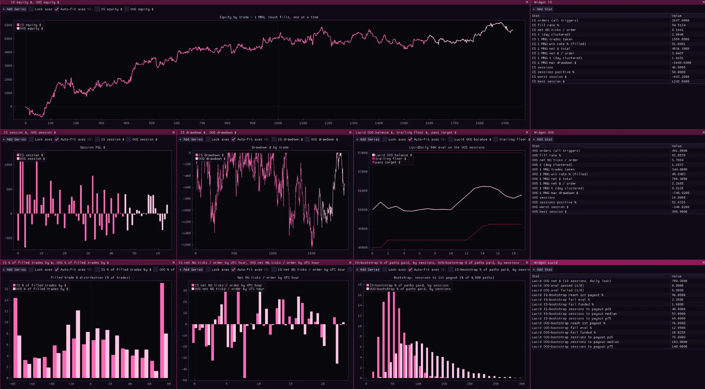

# AZBacktest: C++ Backtesting Framework for Tick Data

### **Docs are in wiki!**

**Before building, edit `config.toml` to map your data columns and set the data path. If the file doesn't exist, the first run will generate one with placeholder values.**

AZBacktest is a C++17 backtesting framework for algorithmic trading strategies on tick data. Header-only API (also available as a single-header amalgamation), CSV and Parquet data support (Databento-style formats work out of the box), and an ImGui/ImPlot visualization window.

Note: Release files are frequently out of date. Clone and build the project if its missing a feature you require.  

## Build

```bash
# run a strategy
bash build.sh -runfile exampleStrategies/BuyAndHold.cpp

# generate single-header amalgamation (azbacktest.h)
bash build.sh

# build and run the unit tests
bash build.sh -tests

# clean leftover build artifacts
bash build.sh -clean
```

Requires g++ with C++17 (C++20 if Parquet support is linked in, see below), GLFW and OpenGL (vendored under `vendor/`).

## Tests

Tiny note: All tests (that I commited, that is) are AI written. I plan to be transparent on my AI use for this project, which is why I am adding this.    

`bash build.sh -tests` compiles every `tests/test_*.cpp` and runs them, printing a line per test plus a per-suite summary. It exits non-zero if anything fails, so CI can gate on it.

Each test file becomes its **own binary** rather than one linked suite. `backtestApi.h` declares `trades`, `realizedProfit`, and `equityCurve` as non-`inline` globals, so two test TUs including it would collide at link time. Separate binaries also stop the global `kCSVMapping` leaking between files.

Tests run on fake data: `tests/fakeData.h` provides a `TempCsv` helper that writes a fixture to a scratch file and deletes it on destruction, so nothing is checked into the repo and each test states the rows it cares about right next to its assertions. `azt::useFixtureMapping()` points `kCSVMapping` at the shared fixture layout; call it at the top of any test that reads data, then override whichever fields the test is exercising.

Adding a test:

```cpp
#include "tests/testFramework.h"
#include "tests/fakeData.h"
#include "src/marketData.h"

TEST(myThingWorks) {
    azt::useFixtureMapping();
    azt::TempCsv csv(azt::basicTicks());
    MarketData md(csv.path());

    auto t = md.nextTick();
    REQUIRE(t.has_value());   // fatal, bails out of this test
    CHECK_F(t->size, 3.f);    // non-fatal, keeps going
}
```

No `main()` needed, `testFramework.h` supplies one. Assertions are `CHECK`, `CHECK_EQ`, `CHECK_NE`, `CHECK_NEAR`, `CHECK_F` (float compare at a fixed tolerance), and `REQUIRE`. Everything except `REQUIRE` is non-fatal, so one run surfaces every problem in a test rather than stopping at the first.

Fixtures are CSV, so the Parquet backend isn't covered by these.

## Runner, bars and day numbers

`Backtest` owns the wiring (price vector, data file, `DataApi`, `TradeApi`), so a strategy is just the loop:

```cpp
Backtest bt(0.25, 0.50, kCSVMapping.path);
bt.eachSpan(kDay, 300, kDayStart, [&](const DataWindow& day, const DataWindow& prev) {
    const double prevAtr = atr(prev);              // prev is empty on the first day
    for (auto b : bt.bars(day)) {                  // sets the price and ticks the trade per bar
        if (b.close > b.open) bt.trade.openLong(b.i);
    }
});
```

- `eachWindow(next, f)` is the same loop over any source of windows (a cache, say), `eachSpan` feeds it from the data file. Both close the open trade at the end and return the last window.
- `Bar` is what you get from `w[i]` or `for (auto b : w)`: `open high low close volume buys sells delta restingBid restingAsk bid ask ts tsEvent row action side`, plus `b.extra("name")`. They're references into the window.
- `DayIndicators.h`: `dayStats(w, keep)` (open/high/low/close/volume/vwap/range/atr/realizedVol), `atr`, `vwap`, `trueRange`. `keep` is an optional `bool(const Bar&)` to leave bars out, `prevClose` adds the overnight gap.
- `md.progress()` is 0..1 through the file. It replaces `fetchEOF`/`eof`, which pre-scanned the whole file.

## Windows by time span

`requestDataWindow(md, n)` returns the next `n` rows. To get "one day of data" without tracking the clock yourself, ask for a span instead:

```cpp
const long long kDay = 86'400LL * 1'000'000'000LL;   // spans are in nanoseconds
for (;;) {
    // one UTC day per window, 5 minute bars, at most 5000 bars in memory at a time
    DataWindow w = data.requestDataWindowNanos(md, kDay, 300, 5000);
    if (w.prices.empty()) break;                      // end of data
    // ... process w ...
    if (w.spanDone) { /* that was the last window of the day */ }
}
```

- `requestDataWindowNanos(md, spanNanos, timeframe, maxRows, offsetNanos)` cuts windows on a clock-anchored grid, `[k * span + offset, (k + 1) * span + offset)`. A gap in the data just skips the empty spans.
- `requestDataWindowBy(md, key, timeframe, maxRows)` is the general form: `key` maps a row's ts_recv in epoch nanoseconds to any id and the window ends where the id changes. Use it for things a fixed length can't express, e.g. New York days across daylight saving.
- `maxRows` caps one returned window, so a long span comes back in chunks instead of sitting in memory whole. `spanDone` is `false` on every chunk of a span but the last, and the next call carries on in the same span. `0` means no cap.
- `timeframe` works as in `requestDataWindow`: `0` is raw ticks, `> 0` is bars. A bar belongs to the window of its closing row.
- An empty window always and only means end of data.

## Configuration

Edit `config.toml` to point at your data file (CSV or Parquet, see below) and map column indices.
If `config.toml` doesn't exist, the first run will generate one with placeholder values and exit so you can fill it in.
Note: If you use the header file (from releases) you'd have to search for the mapping itself, and change it directly.

```toml
# absolute path to the data file (CSV or Parquet)
path = "C:/path/to/your/data.csv"

# column indices (0-indexed)
# tsRecvCol is the timestamp used for bar windowing/sorting - if your data
# doesn't distinguish recv/event time, just point it at whatever column
# carries the timestamp
tsRecvCol = 0
priceCol  = 8
sizeCol   = 9

skipHeader = true

# event timestamp + row/sequence number columns, set either to -1 to disable
# on Databento TBBO these are ts_event and sequence
tsEventCol   = -1
rowNumberCol = -1

# symbol filtering (set symbolCol to -1 to disable)
symbolCol  = -1
symbol     = ""
symbolRoll = false

# aggressor/side classification (set aggressor to -1 to disable)
# these are the literal strings in your side column, not fixed labels - check
# them against your data. Databento, for one, encodes the initiating side, so
# it's "B" (bid side / buy aggressor) and "A" (ask side / sell aggressor)
aggressor                = -1
buySideAggressorAlias    = "B"
sellSideAggressorAlias   = "S"
unknownSideAggressorAlias = "N"

# resting (top-of-book) size columns (set to -1 to disable)
# a per-row snapshot of what's sitting on each side of the book, not traded
# volume - on Databento TBBO these are bid_sz_00 / ask_sz_00
restingBidCol = -1
restingAskCol = -1

# best bid/ask price columns (set to -1 to disable)
# quote snapshots at the time of each row, on Databento TBBO these are
# bid_px_00 / ask_px_00. Parquet sources need them as doubles
bidPriceCol = -1
askPriceCol = -1

# book-event classification (set actionCol to -1 to disable)
# a per-row snapshot like the resting/bid-ask columns, not summed across a bar
# these are the literal strings in your action column - Databento's MBO/MBP
# schemas use A/C/M/T/F/R for Add/Cancel/Modify/Trade/Fill/Clear(book reset),
# anything else (including a disabled column) lands on actionNoneAlias
actionCol         = -1
actionAddAlias    = "A"
actionCancelAlias = "C"
actionModifyAlias = "M"
actionTradeAlias  = "T"
actionFillAlias   = "F"
actionClearAlias  = "R"
actionNoneAlias   = "N"

# CSV only: skip every row whose action isn't actionTradeAlias (needs actionCol)
# on MBP schemas every add/cancel/modify is a row and its price is a resting
# order's, so bar highs/lows/volume are only real trades with this on
tradesOnly = false

# ---- data layout (1.2.0), CSV only, everything defaults to the behaviour above ----

# every *Col key also takes a header name instead of an index, e.g. priceCol = "price"

# how the timestamp column is written: iso8601 (default), epoch_s, epoch_ms, epoch_us, epoch_ns, date
timeFormat = "iso8601"

# field separator ("," default, "tab", ";", "|") and whether "..." quoting is honoured (slower)
delimiter = ","
quoted    = false

# rows with a missing / non-numeric price or timestamp are skipped (MarketData::skippedRows()) instead of becoming price 0
skipBadRows = true

# ticks: rows get aggregated into timeframe bars (default)
# rows : every row already is a bar, priceCol is the close, openCol / highCol / lowCol are optional
barMode = "ticks"
openCol = -1
highCol = -1
lowCol  = -1

# [extra] and [filter] are sections, put them at the end of the file (after [dateFormat] and the like)
# any number of extra numeric columns, read with w.extra("iv") on a DataWindow
# "column" or "column:agg", agg folds them into a bar: last (default) first sum min max mean
# [extra]
# iv = "implied_vol:mean"

# keep only rows passing every condition, checked before the symbol logic
# key = column (name or index), value = optional operator then operand: == != < <= > >= ~ (contains) !~ (doesn't contain)
# numbers compare numerically, anything else as text
# [filter]
# action = "T"       # trades only
# symbol = "!~-"     # drop calendar spreads like NQU6-NQZ6
# price  = ">0"

# trading costs, pts
commission = 0.0
spread     = 0.0

# ms of delay
timingCost = 0

# substring offsets for pulling Y/M/D out of the timestamp column
# defaults match Databento's ISO-8601 format: 2025-06-01T22:00:00.065308005Z
[dateFormat]
yearOffset  = 0
yearLength  = 4
monthOffset = 5
monthLength = 2
dayOffset   = 8
dayLength   = 2

# matplot++ chart styling (openLineChart etc.), colours/widths/markers are set
# per series instead. fontSize is at a 560x420 figure and scales with the real
# one. any key left out keeps matplot's default
[matplot]
font            = "Helvetica"
fontSize        = 10.0
fontWeight      = "normal"   # normal / bold
titleFontScale  = 1.1        # title size as a multiple of fontSize
titleFontWeight = "bold"
grid            = false
minorGrid       = false
box             = true
```

Note: I realize the vibecoded system for registering a column is overly complex, after doing it myself for `action`.   
I will eventually write a guide and simplifiy the system. 

## CSV toolkit

`src/csv.h` is a standalone CSV reader/writer with no dependency on `kCSVMapping`, so you can use it for any CSV. `MarketData` is built on top of it.

```cpp
#include "src/csv.h"

// reading, mmapped and zero copy, rows are views into the file
csv::FileReader in("trades.csv");            // csv::Options for delimiter, header, quoted fields
int px = in.column("price");
while (auto row = in.next()) total += row->get<double>(px);

// writing, quotes text only when it needs it
csv::Writer out("equity.csv");               // csv::WriteOptions for delimiter, append, float precision
out.header({"ts", "equity"});
out.row(ts, equity);

// whole columns in one call
csv::writeColumns("equity.csv", {"ts", "equity"}, tsVec, equityVec);
auto equity = csv::readColumn<double>("equity.csv", "equity");
```

`MarketDataWriter` goes the other direction from `MarketData`. It writes `Tick`s out in your `kCSVMapping` layout, so the file reads straight back in with the same config. One use is saving resampled bars:

```cpp
MarketData md(kCSVMapping.path);
MarketDataWriter out("bars_1m.csv");
while (auto bar = md.nextClose(60)) out.write(*bar);
```
